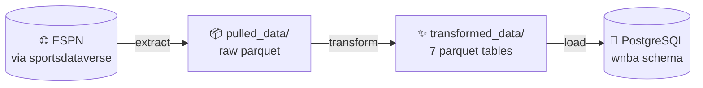
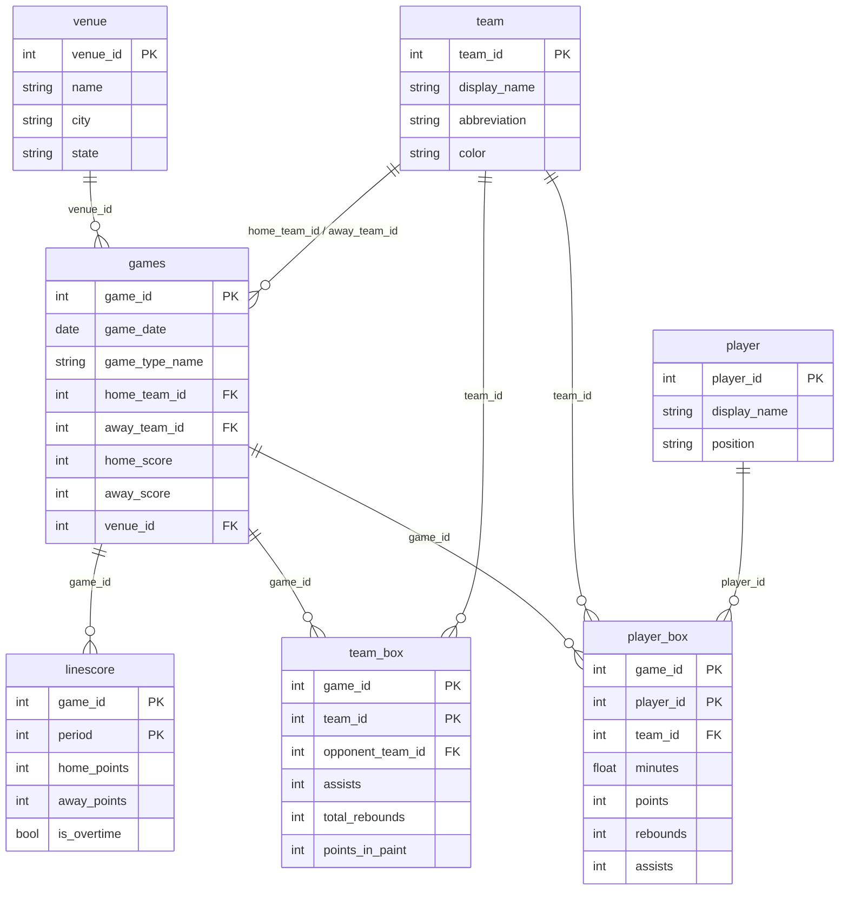

<div align="center">

# 🏀 WNBA Engineering

**A WNBA data pipeline: from the ESPN API to a modeled, analysis-ready Postgres database.**


</div>

---

## ✨ About

ESPN publishes data for every WNBA game, but it arrives **messy**: duplicated columns for the home and away teams, JSON embedded in text fields, abbreviations instead of names, numeric stats stored as text, and team and player details repeated on every row.

This project takes that raw data and turns it into a **clean dimensional model**: fact and dimension tables linked by keys and loaded into Postgres. The goal is that any question about the season can be answered with a `JOIN`.

> _Who was the season's top scorer? Does home court make a difference? How did each quarter of the Finals play out?_

---

## 🔄 How it works



| Step | What it does |
|---|---|
| **Extract** | Downloads each season's schedule, team box scores and player box scores, and stores the raw data as Parquet. |
| **Transform** | Cleans, types and normalizes the data with **Polars**: splits facts from dimensions, parses the embedded JSON, expands abbreviations and drops redundant columns. |
| **Load** | Combines every processed season and refills the Postgres tables (created by the [SQL scripts](wnba_engineering/scripts)) in a **single transaction**. |

---

## 🗂️ Data model



| Table | Type | One row per… | 2026 season |
|---|---|---|---:|
| `games` | fact | game | 354 |
| `linescore` | fact | period of each game | 1,430 |
| `team_box` | fact | team per game | 706 |
| `player_box` | fact | player per game | 8,571 |
| `team` | dimension | team | 15 |
| `player` | dimension | player | 245 |
| `venue` | dimension | arena | 26 |

---

## 🚀 Getting started

### 1. Create the `.env`

Copy the example and set a password:

```bash
cp .env.example .env
```

```env
# Postgres container (used by the db service)
POSTGRES_USER=wnba
POSTGRES_PASSWORD=change-me
POSTGRES_DB=wnba

# connection used by the ETL load
WNBA_PG_URL=postgresql://wnba:change-me@db:5432/wnba
```

> 🔒 `.env` is in `.gitignore`, so your password stays out of the repository.
> Use the same password in `POSTGRES_PASSWORD` and `WNBA_PG_URL`.
> The host is `db` when the ETL runs in Docker, and `localhost` when it runs locally with uv.

### 2. Set up the database

The tables are created by numbered SQL scripts in [`wnba_engineering/scripts/`](wnba_engineering/scripts), run in order:

| Script | Creates |
|---|---|
| `01_create_schema.sql` | the `wnba` schema |
| `02_create_dimensions.sql` | `venue`, `team`, `player` |
| `03_create_facts.sql` | `games`, `linescore`, `team_box`, `player_box`, with primary and foreign keys |
| `04_create_indexes.sql` | indexes on the join and filter columns |

**Option A: Postgres in Docker.** The `db` service runs the scripts automatically on its first start:

```bash
docker compose --env-file .env -f wnba_engineering/docker/docker-compose.yml up -d db
```

> 💡 If port 5432 is already in use on your machine, uncomment `POSTGRES_PORT=5433` in `.env`.
> The scripts only run when the database volume is empty. To recreate the tables from scratch, run `down -v` (this erases the data).

**Option B: an existing Postgres (e.g. a VPS).** Run the scripts once with `psql`:

```bash
for f in wnba_engineering/scripts/*.sql; do psql "$WNBA_PG_URL" -f "$f"; done
```

The scripts use `IF NOT EXISTS`, so running them again is safe.

### 3. Run the pipeline

**With Docker (recommended):**

```bash
# full pipeline (extract + transform + load) for the 2026 season
docker compose --env-file .env -f wnba_engineering/docker/docker-compose.yml run --rm etl

# choosing steps and seasons
docker compose --env-file .env -f wnba_engineering/docker/docker-compose.yml run --rm etl --etl 1 --season 2025 --season 2026
docker compose --env-file .env -f wnba_engineering/docker/docker-compose.yml run --rm etl --etl 1 --extract 0
```

The Parquet files are stored in the `wnba_pulled_data` and `wnba_transformed_data` volumes, so they persist between runs.

> ⚠️ `docker compose down -v` deletes the volumes. After that, the next load only includes the seasons you process again.

**Locally with uv** (with `localhost` in `WNBA_PG_URL`):

```bash
uv sync
uv run main.py --etl 1
```

### ⚙️ Options

`main.py` reads `WNBA_PG_URL` from `.env` on its own.

| Command | What runs |
|---|---|
| `main.py --etl 1` | the full ETL: extract + transform + load |
| `main.py --etl 1 --load 0` | download and transform, without loading into the database |
| `main.py --etl 1 --extract 0` | transform what was already downloaded, then load |
| `main.py --etl 1 --extract 0 --transform 0` | only load what is in `transformed_data/` |
| `main.py --etl 1 --season 2025 --season 2026` | multiple seasons (default: `2026`) |
| `main.py --etl 0 --dashboard 1` | refresh the dashboard data and open it at http://localhost:3000 |

Or use the shortcuts in `launcher.py`:

```bash
python launcher.py --mode etl              # full ETL
python launcher.py --mode transform-load   # transform + load, no download
python launcher.py --mode load             # load only
python launcher.py --mode dashboard        # refresh and open the dashboard
python launcher.py --mode all              # ETL + dashboard
```

The load empties and refills the tables on every run, so running it again never duplicates data.

### 🏀 Dashboard

`wnba_engineering/dashboard` is **Courtside**, a static site (Vite + d3, no framework). `npm run data` dumps the raw tables (`team`, `player`, `games`, `player_box`) from Postgres to `public/data/*.json`, using `WNBA_PG_URL` from the root `.env`; standings, averages, True Shooting % and Game Score are then computed in the browser (`src/data.js`).

```bash
cd wnba_engineering/dashboard
npm install
npm run data    # export from Postgres
npm run dev     # http://localhost:3000
npm run build   # static site in dist/
```

### 4. Query it!

```sql
-- season scoring leaders (minimum 10 games)
SELECT p.display_name, t.abbreviation AS team, round(avg(pb.points), 1) AS ppg
FROM wnba.player_box pb
JOIN wnba.player p USING (player_id)
JOIN wnba.team   t USING (team_id)
WHERE NOT pb.did_not_play
GROUP BY 1, 2
HAVING count(*) >= 10
ORDER BY ppg DESC
LIMIT 10;
```
